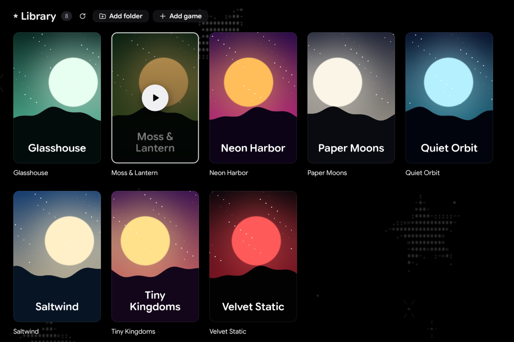

<p align="center"></p>

<h1 align="center">Run games with a Steam Fix / Online Fix on Linux</h1>



## Install

Arch, Fedora, Ubuntu and most other x86_64 distros (glibc 2.35 or newer)

```sh
curl -fsSL https://raw.githubusercontent.com/Kalkaro/asterisk-ofix/main/install.sh | bash
```

NixOS

```sh
nix profile add github:Kalkaro/asterisk-ofix
```

Run the install again to update. To uninstall, change `bash` to `bash -s -- --uninstall`
(your saves stay).

It needs a native Steam install; Flatpak and Snap Steam aren't supported.

## Usage

Put your games in `~/Games`, or add another folder with **Add folder**. Any folder with a
Steam Fix / Online Fix in it (`SteamFix*.dll`/`.ini` or `OnlineFix*.dll`/`.ini`) shows up as a
game. **Add game** takes an `.exe` directly.

**Install** installs a game for you: choose the game's installer (a repack's `setup.exe`) and
its online fix in the popup. A fix downloaded next to the installer's folder is filled in for
you; it's optional. Both run silently through Proton, the game first and the fix after, into
`~/Games/asterisk/<game>`. Inno Setup and NSIS installers work.

Steam has to be running and logged in. If it isn't, Play starts it; press Play again once
you're logged in.

Every game gets its own Wine prefix, in `~/.local/share/asterisk-ofix/prefixes/`. Your saves
live there.

The app speaks English, Russian, Ukrainian, German, French, Spanish, Brazilian Portuguese,
Polish, Turkish, Simplified Chinese and Japanese. It follows your system's language; the globe
at the end of the header picks another.

Settings are in `~/.config/asterisk-ofix/config.json`, and each game's last log is in
`~/.local/share/asterisk-ofix/logs/`.

There's also a command line, for scripts:

```sh
asterisk-ofix --launch ~/Games/SomeGame          # start a game and wait for it to exit
asterisk-ofix --launch path/to/game.exe --print  # show the command instead of running it
asterisk-ofix --install 'Game v1.0 by Someone/setup.exe' Game-Fix.exe  # install both silently
```

## Building

```sh
nix run .                                 # build and start it
nix build && ./result/bin/asterisk-ofix   # just build it
nix develop -c cargo run                  # quick dev build
```

Without Nix, use cargo with Rust 1.99.1, pkg-config, and the libxkbcommon and Wayland dev
packages:

```sh
cargo +1.99.1 build --release   # ./target/release/asterisk-ofix
```
